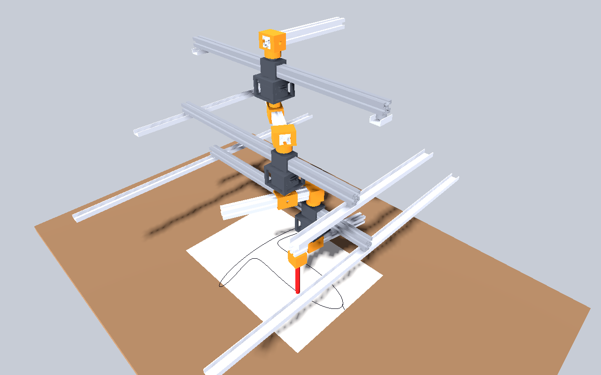

# Robot Art URDF → Godot-ROS-custom-build (v3)

Drop-in files that let the godot_urdf addon in **MOVER6-Simulation-in-Godot-from-URDF**
(the Godot project inside Godot-ROS-custom-build) load the epicycle drawing robot.
I tested it in Godot 4.4.1 with Jolt physics. The ROS 2 bridge isn't tested because
that needs your custom build.



## The v3 design in one paragraph

Every layer's 500 mm support bar points the same way and never turns. Each end of the bar runs in a
U-channel track fixed to the frame, and the motor carriage slides along the bar. So every motor
body always faces the same way, and **joint k sets the absolute direction of arm k**:
pen = Σ rₖ (cos qₖ, sin qₖ). The top bearings (`pivot2..3`) and the bar slides (`support1..3`) are
passive and follow by themselves.

## What's in here

| Path | What it is |
|---|---|
| `robot_art/robot_art_3_layers.urdf` (+ `.yaml`) | 3 layers + gantry bar + pen + the tracks. The `.yaml` tells the addon to look for meshes in `res://robot_art`. |
| `robot_art/robot_art_single_layer.urdf` (+ `.yaml`) | One layer with its tracks (same as the STEP file). |
| `robot_art/robot_art_layer/meshes/*.stl` | Meshes. `package://robot_art_layer/meshes/x.stl` resolves to `res://robot_art/robot_art_layer/meshes/x.stl`. |
| `addons/stl-io/`, `addons/yaml_dot_gd/` | Your two other addons, unchanged, so a folder replace can't lose them. |
| `addons/godot_urdf/` | The whole addon (23 scripts). The 5 files below are the ones I changed; the rest are your originals. |
| `addons/godot_urdf/urdf_parser.gd`, `urdf_data/urdf_joint.gd` | **Patched.** Reads URDF `<mimic>` tags (they used to be skipped). |
| `addons/godot_urdf/urdf_6dof_joint3d.gd` | **Patched.** Adds prismatic joints (they were locked solid) and passive joints (`effort="0"`). Continuous joints now spin about the joint's local X, which stops Jolt jamming at ±180° (see below). |
| `addons/godot_urdf/urdf_geometry_factory.gd` | **Patched.** Fixes URDF `<box>` sizes and `<cylinder>` orientation. |
| `addons/godot_urdf/controller/RobotJointController.gd` | **Patched.** Adds prismatic joints, kinematic mode, mimic joints, guided slides, joint offsets, `min_link_mass` and `disable_self_collision`. |
| `robot_art_demo.gd`, `RobotArt.tscn` | A ready scene: it loads the robot, spins it as an epicycle drawer and draws the pen trace on an A3 sheet. |

### About your Mover6
`Robot.tscn` stores its joints already built, so it behaves as before (I ran it). If you press
**Reload robot** on the Mover6, its continuous joints are rebuilt to spin about X. I tested a reload with the
new addon: all 6 joints reached their targets to within 0.0001 rad.

## Install

**If an earlier copy deleted files** (errors about `YAMLParser`, `GodotRobot`, `URDFLink`…, or the
Mover6 meshes are gone), first get your originals back with git, from the Mover6 project folder:
```bash
git status            # shows what was deleted
git restore addons urdf
```

Then:
1. Copy everything in this folder into the root of the Mover6 project (the folder with `project.godot`).
   From a terminal (this merges, so nothing gets deleted):
   ```bash
   cp -r godot_robot_art/. /path/to/MOVER6-Simulation-in-Godot-from-URDF/
   ```
   If you use a file manager instead, it's still safe if it replaces folders: `addons/` holds all three
   addons (`godot_urdf` patched, `stl-io` and `yaml_dot_gd` unchanged), and the robot lives in its own
   new folder, `robot_art/`. Your `urdf/` folder is never touched.
2. Open the project. Godot imports the URDFs and STLs automatically.
3. Open `RobotArt.tscn` and press **F6** (Run Current Scene).

### Physics settings (only needed with kinematic mode off)
Project Settings → Physics (turn on *Advanced Settings*):

```
Common › Physics Ticks per Second                     480
Jolt Physics 3D › Simulation › Velocity Steps          30
Jolt Physics 3D › Simulation › Position Steps          20
Jolt Physics 3D › Simulation › Baumgarte Stabilization Factor  1.0
```

## Kinematic vs physics mode (`RobotArt` node → *Kinematic Mode*)

* **On (default):** the parts are placed exactly from the joint values each frame. Each frame the
  top bearings are set to −(joint above), and each support bar is kept centred between its tracks.
  I checked the pen tip against the URDF's own forward kinematics: the error is 0.00 mm, every motor stays at 0.000°
  and every bar stays centred to 0.00 mm. Use this mode for checking drawings and for shadowing the real robot.
* **Off:** full Jolt physics. The demo adds a guide to each support bar that stops it sliding along
  its own length or turning, like the tracks do. Everything else is left to physics, so the bearings
  turn and the bars slide on their own. Over a 30 s drawing at 480 Hz the pen error was
  1.2 mm (median) and 2.8 mm at worst. At 240 Hz it was 7 mm median and 17 mm at worst.

**Why continuous joints changed axis:** Jolt splits a 6DOF joint's rotation into "twist" about X and "swing" about Y and Z.
A free Z axis jammed at ±180° as soon as gravity made the chain sag a little. The arms stopped
dead at q = ±π until I moved the hinges to X.

## Joint names and units (same as the ROS URDF that MATLAB uses)

| Joint | Meaning | Units / range | Who sets it |
|---|---|---|---|
| `joint1..3` | motor of layer k = absolute direction of arm k | rad, continuous | you |
| `clampB1..3` | arm radius of layer k | m, 0.03 – 0.17 | you |
| `pivot2..3` | top bearing (`pivot1` is fixed) | rad, = −joint(k−1) | automatic (`<mimic>`) |
| `support1..3` | support bar centre − carriage centre, along the bar | m, ±0.214 | automatic |

For an epicycle with frequencies n₁, n₂, n₃ and base speed ω₀, **motor k turns at nₖ·ω₀**. You no
longer subtract the layer above. The demo uses *Frequencies* = [1, −2, 3].

**Reach limit:** with 500 mm support bars, the bottom layer's carriage hits a ball unit if
r₁ + r₂ > 214 mm. The demo's radii (100 + 60 mm) are fine. For full reach (340 mm) the bottom
layer would need roughly a 760 mm bar, with its tracks moved out to match.

The Godot URDFs are built with `rest_radius:=0.07`. The demo sets `joint_offsets = {clampB*: 0.07}`, so all values
match `epicycle_layers.urdf` in ROS.

## ROS 2

If the custom build's classes exist (`JointJogController`, etc.), the demo adds `ros_2_arm.gd`
by itself, so `/JointJog` drives the robot and `/joint_states` is published. Demo spinning
is switched off when ROS is active. Notes:
* From MATLAB, publish `joint1..3`, `clampB1..3` and `support1..3`. `robotart_joint_states.m` (in the
  robot_art_layer package, `matlab/`) works out the support values for you. `robot_state_publisher` fills in the mimic pivots.
* `ros_2_arm.gd` clamps a jog to ±1 × `max_joint_velocity`. For `clampB` joints that is m/s, so send small values (≈0.05).
* In physics mode the demo sets `motor_direction_overrides = -1` for the motors, because Jolt's motors turn opposite to
  the URDF axis. A raw `/JointJog` goes through `ros_2_arm.gd` without this sign, so set `joint_sign_overrides` there to −1 (or use kinematic mode).

## Using it in your own Robot scene (ArmRig + ArmController + ROS2)

Use the **Godot copies in `res://robot_art/`**. Don't use the ROS package files (`*_relative.urdf` etc.):
their `../meshes/` paths can't be found from Godot, so you only get collision boxes.

1. **ImportRobot** (`arm_rig.gd`)
   * `Urdf File Path` = `res://robot_art/robot_art_3_layers.urdf` (or `robot_art_single_layer.urdf`)
   * `Package Folder` = `res://robot_art` (not `res://urdf`)
   * press **Load robot**
2. **ArmController** (`RobotJointController`)
   * tick **Kinematic Mode**
   * `Joint Offsets` → add `clampB1`, `clampB2`, `clampB3`, each `0.07` (single layer: `clampB` `0.07`)
   * leave **Auto Track Guides** ticked: it centres each support bar between its `track…_L/_R` links
3. **ROS2**: nothing to change. It drives ArmController as before.

The big light-blue wireframes you see in the editor are just the 6DOF joint gizmos.
They don't show in the running game. The single-layer URDF sits where it is in the STEP file
(about 0.5 m along X), so set `Robot Position` to `(-0.499, 0, 0.026)` on ImportRobot to bring it to the origin.

If you'd rather use the URDF importer instead: drag `res://robot_art/robot_art_3_layers.urdf` into a scene.
The `.yaml` file next to it already points the importer at `res://robot_art`.

## Rebuilding the URDFs after CAD changes (in the robot_art_layer package)

```
xacro urdf/epicycle_layers.urdf.xacro rest_radius:=0.07  > robot_art_3_layers.urdf
xacro urdf/single_layer.urdf.xacro    rest_radius:=0.07  > robot_art_single_layer.urdf
```
